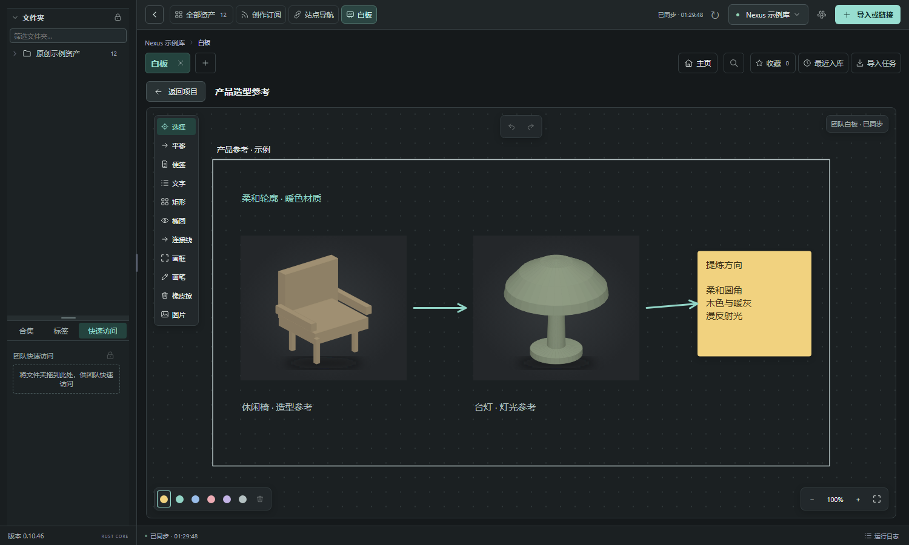

# Nexus Assets · 资产工作台

Nexus 把本地磁盘和 NAS 上的模型、贴图、材质与视频放在同一个工作台里。可以搜索和预览素材，在白板上整理参考，再把模型或材质送进 Blender、Cinema 4D 等创作软件。

[下载 Windows x64 最新版](https://github.com/Jugui-Lin/nexus-assets/releases/latest) · [团队部署与使用](团队版部署与使用.md) · [NAS 镜像更新](nas/README.md#github-镜像自动更新)

本页对应 Windows 客户端 v0.10.58。 [版本更新说明](https://github.com/Jugui-Lin/nexus-assets/releases/tag/v0.10.58)


## 安装和更新

| 操作 | 入口 |
| --- | --- |
| 首次安装 | 下载并运行 Windows x64 安装包。 |
| 客户端更新 | Windows 版在后台下载并验签。空闲至少 5 分钟时，或关掉后下次打开时，会自动安装并重启。已下载的更新可以离线安装。更新就绪后，也可在「关于 Nexus」点「立即安装并重启」。有导入或未保存编辑时会等待当前操作完成。也可直接运行新版安装包覆盖升级。 |
| 卸载 | 打开 Windows「设置」→「应用」→「已安装的应用」，找到 Nexus Assets 并选择「卸载」。 |
| 查看团队服务版本 | 切到团队库，在设置菜单最下方打开「关于 Nexus」。「团队服务版本」来自当前连接的服务。旧服务升级后可报告自身版本号。 |

## 整理素材

1. 从「导入或链接」选择文件或文件夹。团队库可将素材复制到 NAS，也可以链接 NAS 上已有的共享目录。
2. 用类型、标签、评分和格式筛选。结果数量下方显示当前条件，可逐项移除，也可点「清除筛选」。
3. 双击资产或按 `Space` 快速预览，用方向键切换，用 `Esc` 关闭。右键可设封面、复制路径或在资源管理器中打开位置。

同名 JPG / PNG 和目录中的 `preview.jpg`、`preview.png` 可作为封面。搜索匹配名称、路径和备注。从资产目录搜索时可切换「当前目录」「当前库」或「全部库」。按原件位置分组后，可从组标题直接打开文件夹，也可一键折叠全部。已识别的 NAS 映射路径和 UNC 路径可归到同一原件位置。

## 数据库、缩略图和素材目录

| 工作空间 | 设置方式 |
| --- | --- |
| 个人库 | 点右上角的库名称，选「新建个人库… → 选择数据目录…」。所选空文件夹保存 `nexus.sqlite3`、`thumbnail-cache` 和 `indexed-thumbnails`。随后可通过「导入或链接」接入不同磁盘上的素材目录，链接的原件留在原位置。 |
| 团队库 | 团队服务统一保存索引、标签、备注和成员资料。NAS 部署使用部署目录中的 `data/team.sqlite3`。在「团队文件夹设置」可分别链接素材目录，并为各客户端选择原件挂载路径。 |
| 团队共享缩略图 | 在「团队文件夹设置 → 团队共享缩略图缓存」选择一个可写的 NAS 文件夹。这个设置按团队保存在各成员的电脑上，选择同一个缓存目录即可共用已生成的缩略图。 |

切到团队库即可浏览已同步的索引和资料，也可查看能访问的缓存缩略图。打开原件、全尺寸预览和向 DCC 发送素材都需要访问原件目录。要启用 NAS 自动扫描，在容器中另行挂载要扫描的素材目录。 [NAS 部署与扫描](nas/README.md#服务器自动扫描素材)

<details>
<summary>打开已有库、预览和缓存</summary>

- 从右上角的库名称切换工作空间，也可打开含有 `nexus.sqlite3` 的现有库。「工作空间设置」会显示当前个人库的数据目录。「迁移数据库…」会复制索引、封面和历史版本并保留源目录，缩略图缓存可在新位置重新生成。
- 要只看当前目录，取消「包含子文件夹」。筛选后可用「记住此处」保存当前条件，也能将常用文件夹拖入「快速访问」。
- 可预览图片、兼容视频和部分 3D 文件。OBJ、STL、网格 PLY、静态 GLB 及内嵌几何的 glTF 支持旋转、缩放和线框预览。选择 2 至 4 项资产可并排对比。
- 「缩略图设置」可设置尺寸并批量生成。右下角的「运行日志」可查看和复制本次打开软件后的同步、导入和错误记录。

</details>

## 文件夹与资产库联动

- 文件夹默认堆叠序列帧，也可在「查看 → 显示」关闭。像 `S04_11180000.exr` 这样以日期和帧号相连命名的图片也能堆叠。PNG 和 EXR 分别分组，开启缩略图时图标视图会用第一帧做封面，点堆叠可展开单帧。
- 文件夹默认隐藏「未入库」标记，可在「查看 → 显示」打开。有资产标签页时，关闭最后一个文件夹标签页会回到资产库。再次进入文件夹时才打开新的标签页。
- 文件夹工具栏可复制、剪切、粘贴、重命名和删除。右键菜单会贴近点击位置，菜单较长时可滚动。
- 在文件夹选中文件后点「在资产库中查看」，可定位对应的资产并保留多选。若筛选隐藏了部分结果，点「查看文件夹选区」，看完可返回原视图。
- 在资产库多选后点「定位原件」，可按目录打开所选文件的位置，并复用已有的文件夹标签页。完成跨工作区定位后，用顶部的「返回原视图」回到发起操作的标签页。
- 在文件列表或资产网格中按 `Ctrl+Shift+C` 可复制所选原件路径。右键还可复制原文件名，或把路径复制为 Windows 参数、PowerShell 或 JSON。
- 在文件夹中右键已入库文件，选「资产评分」可设置 1 至 5 星或清除评分，资产库立即显示修改结果。可批量为能唯一匹配且可编辑的资产评分。以文件夹启动时，可先在「查看 → 显示资产状态」加载资产信息。
- Windows 个人库可用右键「移动原件并保留资产记录…」，在受支持的本地目录间移动已入库文件。移动中断后，Nexus 会尝试恢复，遇到冲突会列出受影响的路径。
- 从文件夹右键选「添加到白板…」，可把已入库的图片和视频作为引用加入白板。用「发送到 Cinema 4D…」可把兼容素材送到指定的在线实例。
- 从文件夹把文件拖到「素材篮」即可加入备选。素材篮记录原件路径，显示引用数量，并支持按篮中顺序连续预览。
- 「＋」菜单可直接新开白板标签页。先打开资产库时，新建的「此电脑」标签会出现在已有资产标签右侧。
- 资产详情停靠底部时，预览、文件信息、编辑和发送操作按可用宽度并排显示。

## 用白板整理参考

在资产库选中图片或视频，按 `Ctrl+C`，切到同一库的白板按 `Ctrl+V` 粘贴引用。白板可以框选、对齐、成组和连线。通过「查找与大纲」可展开画框、定位元素，或按素材名、便签内容和审片标注搜索并跳转。



| 操作 | 快捷键或手势 |
| --- | --- |
| 成组与解组 | `Ctrl+G` / `Ctrl+Shift+G` |
| 撤销与重做 | `Ctrl+Z` / `Ctrl+Shift+Z` |
| 吸附邻边 | 移动元素时按住 `Shift+Space` |
| 连线 | 从元素边缘的「＋」拖到另一项 |
| 查找与大纲 | `Ctrl+F` |
| 选中同类或同色元素 | `Shift+K` / `Shift+B` |

## 网页采集与 DCC

- 在「站点导航」按住分类标题上下拖动，可移动整个站点分组。分组顺序会保存。
- 在「网页采集」安装并配对 Chrome 或 Edge 扩展，然后选择采集素材的目标库与目录。 [扩展使用说明](browser-extension/README.md)
- Nexus 自动检测创作软件并安装或更新桥接。重开创作软件后，可在「DCC 连接中心」查看在线状态。自定义的 Windows 安装未被检测到时，可在这里选择程序。Cinema 4D 已检测到其他版本时，可用「查找其他版本…」。首次启动 Cinema 4D 会生成桥接所需的用户首选项目录。
- Cinema 4D 2023 和 2024 支持基础导入，可把 C4D、FBX、OBJ、Alembic 和 STL 合并到当前场景。
- 从资产库或文件夹把 FBX、OBJ 和 MAX 发送到在线的 Cinema 4D 2023 实例，可智能导入到当前场景。Nexus 会自动查找模型附近匹配的贴图，生成或补齐标准材质。
- Cinema 4D 2025 及以上版本的智能导入和视口放置按在线实例显示的能力提供。智能导入支持模型、PBR 贴图、HDRI 和 IES。
- 发送 MAX 时可沿用工作区保存的读取方式，也可为本次导入选择读取方式。「Blender 直接解析」需要 Blender 4.2 或更新版本。「调用 3ds Max Batch」需要 Windows 上已安装并完成授权的 3ds Max Batch。
- Windows 上可把 MAX 拖进 Blender 4.5 或更新版本的 3D 视口。桥接安装或更新后，重开 Blender 即可使用。

在 Blender 视口放置时用 `S` 缩放、`R` 旋转。在 Cinema 4D 用 `T` 缩放、`R` 旋转，再按住左键拖动调整。左键确认放置，`Esc` 取消。导入任务收到 DCC 回执后会显示结果。

已用带贴图的 MAX 场景在 Blender 和 3ds Max Batch 中验证 FBX 转换。Cinema 4D 2023 的导入流程通过模拟测试，实际宿主内合并待验证。

## 从源码运行

桌面端使用 Rust、Tauri 2 和 SQLite，界面使用 HTML、CSS 和 JavaScript。Windows 需要 Rust stable MSVC、Microsoft C++ Build Tools 和 Edge WebView2 Runtime。

```powershell
cargo test --manifest-path src-tauri/Cargo.toml
cargo run --manifest-path src-tauri/Cargo.toml
```

安装 Tauri CLI 后，在 `src-tauri` 下运行 `cargo tauri build` 可生成安装包。界面开发可运行 `node server.mjs`，预览数据存放在 `data/preview`。macOS 构建脚本位于 [scripts/build-macos.sh](scripts/build-macos.sh)，仍需在 Mac 上验证。
