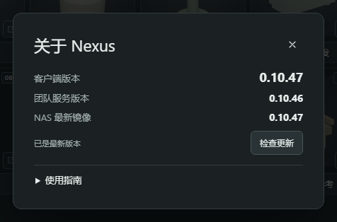

# Nexus Assets · 资产工作台

Nexus 把本地磁盘和 NAS 上的模型、贴图、材质与视频放在同一个工作台里。可以搜索和预览素材，在白板上整理参考，再把模型或材质送进 Blender、Cinema 4D 等创作软件。

[下载 Windows x64 最新版](https://github.com/Jugui-Lin/nexus-assets/releases/latest) · [团队部署与使用](团队版部署与使用.md) · [NAS 镜像更新](nas/README.md#github-镜像自动更新)


## 安装和更新

| 操作 | 入口 |
| --- | --- |
| 首次安装 | 下载并运行 Windows x64 安装包。 |
| 客户端更新 | Windows 版在后台下载并校验签名，空闲至少 5 分钟后自动安装并重启。更新就绪后，也可在「关于 Nexus」点「立即安装并重启」。有导入或未保存编辑时会等待当前操作完成。也可直接运行新版安装包覆盖升级。 |
| 卸载 | 打开 Windows「设置」→「应用」→「已安装的应用」，找到 Nexus Assets 并选择「卸载」。 |
| 查看 NAS 版本 | 切到团队库，再打开「关于 Nexus」。「团队服务版本」来自当前连接的服务，「NAS 最新镜像」读取自动更新渠道的稳定版。旧服务需要先更新一次才能报告自身版本号。 |



## 整理素材

1. 从「导入或链接」选择文件或文件夹。团队库可将素材复制到 NAS，也可以链接 NAS 上已有的共享目录。
2. 用类型、标签、评分和格式筛选。搜索框也能匹配名称、路径和备注。
3. 双击资产或按 `Space` 快速预览，用方向键切换，用 `Esc` 关闭。右键可设封面、复制路径或在资源管理器中打开位置。

同名 JPG / PNG 和目录中的 `preview.jpg`、`preview.png` 可作为封面。多人使用同一团队库时，共享索引通过团队服务同步，素材从 NAS 共享路径读取。

<details>
<summary>工作空间、预览和缓存</summary>

- 从右上角的库名称切换工作空间。创建个人库时选择空目录，也可打开含有 `nexus.sqlite3` 的现有库。工作空间设置里的「迁移数据库」会复制索引、封面和历史版本，保留源目录作备份。
- 要只看当前目录，取消「包含子文件夹」。筛选后可用「记住此处」保存当前条件，也能将常用文件夹拖入「快速访问」。
- 可预览图片、兼容视频和部分 3D 文件。OBJ、STL、网格 PLY、静态 GLB 及内嵌几何的 glTF 支持旋转、缩放和线框预览。选择 2 至 4 项资产可并排对比。
- 「缩略图设置」可设置尺寸并批量生成。团队视频缩略图可通过 NAS 共享目录复用。右下角的「运行日志」可查看和复制本次打开软件后的同步、导入和错误记录。

</details>

## 用白板整理参考

在资产库选中图片或视频，按 `Ctrl+C`，切到同一库的白板按 `Ctrl+V` 粘贴引用。白板可以框选、对齐、成组和连线。


| 操作 | 快捷键或手势 |
| --- | --- |
| 成组与解组 | `Ctrl+G` / `Ctrl+Shift+G` |
| 撤销与重做 | `Ctrl+Z` / `Ctrl+Shift+Z` |
| 吸附邻边 | 移动元素时按住 `Shift+Space` |
| 连线 | 从元素边缘的「＋」拖到另一项 |

## 网页采集与 DCC

- 在「网页采集」安装并配对 Chrome 或 Edge 扩展，然后选择采集素材的目标库与目录。 [扩展使用说明](browser-extension/README.md)
- 在「DCC 连接中心」安装桥接插件并重启对应软件。连接后，资产可以发送到指定实例，兼容资产可直接拖入 Blender 或 Cinema 4D 的视口。
- Cinema 4D 智能导入支持模型、PBR 贴图、HDRI 和 IES。直接解析 MAX 需要 Blender 4.2 或更新版本，「调用源软件」使用已安装并完成授权的 3ds Max Batch。

在 Blender 视口放置时用 `S` 缩放、`R` 旋转。在 Cinema 4D 用 `T` 缩放、`R` 旋转，再按住左键拖动调整。左键确认放置，`Esc` 取消。导入任务收到 DCC 回执后会显示结果。

## 从源码运行

桌面端使用 Rust、Tauri 2 和 SQLite，界面使用 HTML、CSS 和 JavaScript。Windows 需要 Rust stable MSVC、Microsoft C++ Build Tools 和 Edge WebView2 Runtime。

```powershell
cargo test --manifest-path src-tauri/Cargo.toml
cargo run --manifest-path src-tauri/Cargo.toml
```

安装 Tauri CLI 后，在 `src-tauri` 下运行 `cargo tauri build` 可生成安装包。界面开发可运行 `node server.mjs`，预览数据存放在 `data/preview`。macOS 构建脚本位于 [scripts/build-macos.sh](scripts/build-macos.sh)，仍需在 Mac 上验证。
